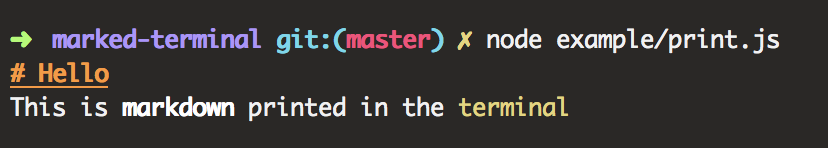
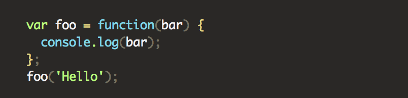

# marked-terminal

> Custom Renderer for [marked](https://github.com/markedjs/marked)
> allowing for printing Markdown to the Terminal. Supports pretty tables, syntax
> highlighting, and overriding all colors and styles.

Could for instance be used to print usage information.

[](https://github.com/mikaelbr/marked-terminal/actions/workflows/ci.yml) [](https://www.npmjs.com/package/marked-terminal)

## Install

```sh
pnpm add marked marked-terminal
```

Requires a Node.js LTS version (>= 22.12) and marked >= 13. TypeScript types are included.

## Example

```ts
import { marked } from 'marked';
import { markedTerminal } from 'marked-terminal';

marked.use(markedTerminal([options][, highlightOptions]));

console.log(marked.parse('# Hello \n This is **markdown** printed in the `terminal`'));
```

The package is ESM-only. It can still be loaded with `require()` from CommonJS,
which is supported natively from Node.js 22.12:

```js
const { marked } = require('marked');
const { markedTerminal } = require('marked-terminal');
```

This will produce the following:



## CLI

marked-terminal also comes with a command line tool, `mt`, for rendering
Markdown files or piped input directly from bash, PowerShell and other shells:

```sh
pnpm dlx marked-terminal README.md   # without installing
pnpm add -g marked marked-terminal
mt README.md
cat CHANGELOG.md | mt --width 60
```

The CLI wraps text and tables to the terminal width (at most 100 columns) and
indents with 2 spaces. Colors are turned off when output isn't a terminal or
`NO_COLOR` is set.

```
Usage: mt [options] [file ...]

Options:
  -f, --file <path>       Markdown file to render (same as passing it as an argument)
  -w, --width <columns>   Width to wrap text and tables at
                          (default: terminal width, at most 100)
      --no-reflow         Don't wrap text and tables to the width
      --color             Force colors, even when not writing to a terminal
      --no-color          Disable colors (also respects NO_COLOR)
      --no-emoji          Don't replace :emoji: codes with emojis
      --no-section-prefix Don't prefix headings with #
  -h, --help              Show this help
  -v, --version           Show version
```

### Syntax Highlighting

Code blocks are syntax highlighted using [emphasize](https://github.com/wooorm/emphasize)
(highlight.js). You can override highlighting defaults by passing in settings as the second argument.

Having the following markdown input:

<pre>
```js
var foo = function(bar) {
  console.log(bar);
};
foo('Hello');
```
</pre>

...we will convert it into terminal format:

```ts
console.log(marked.parse(exampleSource));
```

This will produce the following:



## API

```ts
markedTerminal(options?: TerminalRendererOptions, highlightOptions?: HighlightOptions): MarkedExtension
```

### `options`

Optional. Used to override default styling. Every style is a plain
`(text: string) => string` function, so you can use `node:util`'s `styleText`,
`chalk`, `picocolors` or your own functions.

Default values are:

```ts
import { styleText } from 'node:util';

const defaultOptions = {
  // Colors
  code: (s) => styleText('yellow', s),
  blockquote: (s) => styleText(['gray', 'italic'], s),
  html: (s) => styleText('gray', s),
  heading: (s) => styleText(['green', 'bold'], s),
  firstHeading: (s) => styleText(['magenta', 'underline', 'bold'], s),
  hr: (s) => styleText('reset', s),
  listitem: (s) => styleText('reset', s),
  table: (s) => styleText('reset', s),
  paragraph: (s) => styleText('reset', s),
  strong: (s) => styleText('bold', s),
  em: (s) => styleText('italic', s),
  codespan: (s) => styleText('yellow', s),
  del: (s) => styleText(['dim', 'gray', 'strikethrough'], s),
  link: (s) => styleText('blue', s),
  href: (s) => styleText(['blue', 'underline'], s),
  text: (s) => s,

  // Formats the bulletpoints and numbers for lists
  list: function (body, ordered, indent) {/* ... */},

  // Reflow and print-out width
  width: 80, // only applicable when reflow is true
  reflowText: false, // also shrinks tables wider than `width` (unless tableOptions.colWidths is set)

  // Should it prefix headers?
  showSectionPrefix: true,

  // Whether or not to undo marked escaping
  // of enitities (" -> &quot; etc)
  unescape: true,

  // Whether or not to show emojis
  emoji: true,

  // Options passed to cli-table3
  tableOptions: {},

  // The size of tabs in number of spaces or as tab characters
  tab: 4, // examples: 4, 2, \t, \t\t

  image: function (href, title, text) {} // function for overriding the default image handling.
};
```

Colors are disabled when `NO_COLOR` is set or stdout doesn't support colors,
and can be forced with `FORCE_COLOR`.

#### Example of overriding defaults

```ts
import { styleText } from 'node:util';

marked.use(
  markedTerminal({
    codespan: (s) => styleText(['underline', 'magenta'], s)
  })
);
```

### `highlightOptions`

```ts
interface HighlightOptions {
  // Map of highlight.js classes (without `hljs-` prefix) to style functions.
  // Defaults to `defaultSheet`, a theme matching marked-terminal v7.
  sheet?: Record<string, (text: string) => string>;
  // Languages to consider when auto-detecting code without a language tag.
  subset?: string[];
}
```

```ts
import { defaultSheet, markedTerminal } from 'marked-terminal';

marked.use(
  markedTerminal({}, { sheet: { ...defaultSheet, keyword: (s) => styleText('magenta', s) } })
);
```

See [more examples](./example/)

## Migrating from v7

- Requires a Node.js LTS version (>= 22.12) and marked >= 13.
- The package is ESM-only. `require('marked-terminal')` still works through
  Node's native `require(esm)`.
- The `TerminalRenderer` class (and the default export) is removed. Use the
  `markedTerminal` extension, the
  [recommended way](https://marked.js.org/using_pro#renderer) of overriding
  marked's renderer:

  ```diff
  - import TerminalRenderer from 'marked-terminal';
  - marked.setOptions({ renderer: new TerminalRenderer(options, highlightOptions) });
  + import { markedTerminal } from 'marked-terminal';
  + marked.use(markedTerminal(options, highlightOptions));
  ```
- TypeScript types are bundled; remove `@types/marked-terminal`.
- `highlightOptions` are now `{ sheet, subset }` (see above) instead of
  [cli-highlight](https://github.com/felixfbecker/cli-highlight) options.
  Highlighting uses highlight.js 11, so some code may be colored slightly differently.
- Default styles use `node:util`'s `styleText` instead of chalk. Custom style
  options work as before, as any `(text: string) => string` function.

## Development

```sh
pnpm install
pnpm test        # vitest, including type tests
pnpm lint        # biome
pnpm typecheck
pnpm build       # tsdown -> dist/
```

### Running examples

The examples in [`example/`](./example) are TypeScript and import straight from
`src/`, so there's no build step. Node runs `.ts` files directly through its
built-in type stripping (unflagged since Node 22.18 / 23.6):

```sh
node example/demo.ts               # tour of most features
node example/reflow.ts             # text reflow at a fixed width
node example/usage.ts              # CLI usage/help output
node example/print.ts              # render this README
node example/print.ts path/to.md   # render any Markdown file
```

Edits to `src/` show up on the next run, which makes the examples handy for
checking renderer changes by eye.

## Related

- [ink-markdown](https://github.com/cameronhunter/ink-markdown) - Markdown component for Ink
