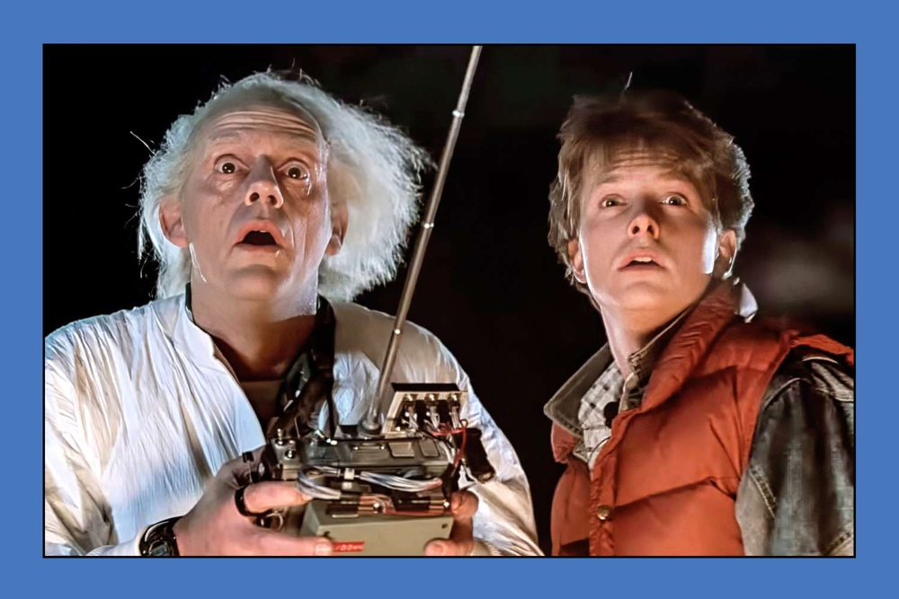

# Images

Images are drawn in full resolution in terminals that support it, and
pixelated in other terminals.

* Images in lists are indented with the item:

  

> Images that can't be loaded are printed as text: 
